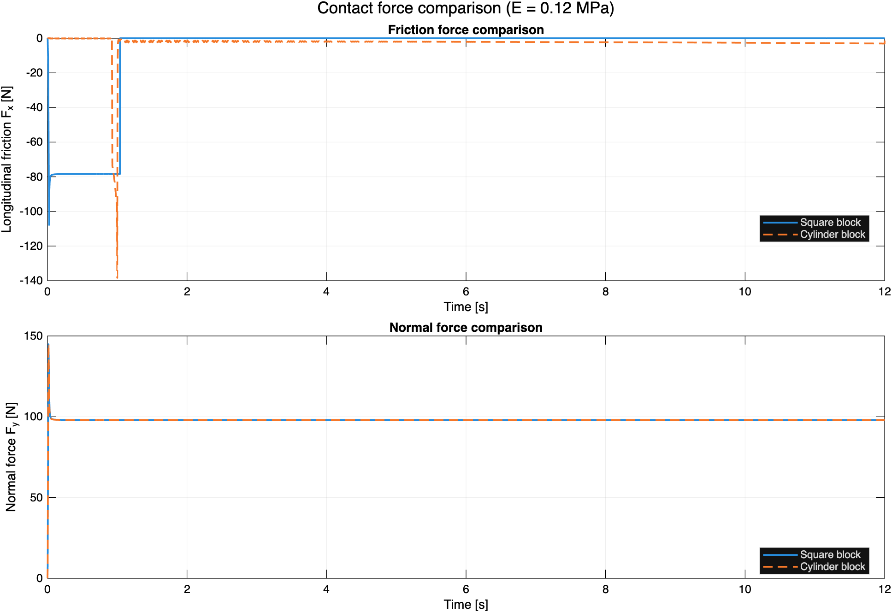

# Simulink Contact Models

Reusable MATLAB/Simulink models for sliding, linear, and rolling contact,
with `rolling_contact_test.slx` as the combined demonstration.

## Repository contents

```text
examples/
  rolling_contact_test.slx   Runnable example containing all three models
docs/
  contact_force_comparison.png
rolling_params.m             Parameters for the example
```

## Requirements

- MATLAB R2026b
- Simulink
- Simscape Multibody
- Mechanics Explorer for the 3D animation

If Mechanics Explorer does not open, make sure Java is enabled and that
`SimMechanicsOpenEditorOnUpdate` is `on` for the model.

## Run the example

From this repository folder:

```matlab
rolling_params
open_system("examples/rolling_contact_test")
```

Run the simulation from Simulink. The example combines the sliding,
linear, and rolling contact models on one mechanical system. Diagnostic
scopes and logging blocks are intentionally omitted from the example.

## Models

### Sliding friction

The sliding model uses a compliant normal contact plus a static/kinetic
friction state. For normal penetration `delta_n` and normal speed `v_n`,

```math
F_n = -k_n \delta_n
      \left(1-\frac{v_n}{v_{n,\max}}\right)
      \mathcal{H}\left(v_{n,\max}-v_n\right).
```

The tangential model selects between static and kinetic friction:

```math
|F_s| \leq \mu_{\mathrm{stick}}F_n,
\qquad
F_k=-\mu_{\mathrm{slide}}F_n\,\mathrm{sgn}(v_t).
```

The static branch retains the foot-point force until its trial elastic force
exceeds the stiction limit. The kinetic branch opposes the tangential slip
velocity.

### Linear contact

The linear model is a spring-damper contact law:

```math
F_c=k_c\,\delta_c
\left(1-\frac{\dot{\delta}_c}{v_{c,\max}}\right)
\mathcal{H}\left(v_{c,\max}-\dot{\delta}_c\right).
```

It is enabled only while contact is present and returns zero when disabled.

### Rolling contact

The contact half-length and normal force come from the compliant vertical
contact:

```math
a=\sqrt{r_w(-\delta_y)},
\qquad
F_n=-\frac{\pi}{4}E\delta_y
\left(1-\frac{v_y}{v_{y,\max}}\right)
\mathcal{H}\left(v_{y,\max}-v_y\right).
```

The implemented low-speed-regularized slip variable is

```math
\lambda=
\frac{-v_x-r_w\omega_z}
{\sqrt{(r_w\omega_z)^2+v_x^2+v_t^2}}.
```

The characteristic slip ratio and brush-model longitudinal force follow
the rolling-contact paper:

```math
\lambda^*=\frac{3\mu_pF_n}{2a^2k_x},
```

```math
F_x=
\begin{cases}
2a^2k_x\lambda
\left(1-\frac{\lambda}{\lambda^*}\right)
+\mu_pF_n\left(\frac{\lambda}{\lambda^*}\right)^2
\left(3-2\frac{\lambda}{\lambda^*}\right), &
|\lambda|\leq\lambda^*,\\[6pt]
F_n\left[\mu_p+
(\mu_s-\mu_p)
\frac{|\lambda|-\lambda^*}{1-\lambda^*}\right], &
\lambda^*<|\lambda|<1,\\[6pt]
\mu_sF_n, & |\lambda|\geq1.
\end{cases}
```

The sign of `F_x` follows the sign of `lambda`. The post-peak branch is
continued smoothly from the measured peak coefficient `mu_p` to the sliding
coefficient `mu_s`.

The contact and rolling-resistance torques are kept separate:

```math
\tau_{\mathrm{contact}}=r_wF_x,
\qquad
\tau_{rr}=-f_{rr}F_nr_w
\tanh\left(\frac{\omega_z}{\omega_{rr,\epsilon}}\right),
```

```math
\tau_{\mathrm{total}}
=\tau_{\mathrm{contact}}+\tau_{rr}.
```

`tau_contact` is generated by tangential slip. `tau_rr` represents hysteresis
and asymmetric pressure in the contact patch, so it remains present during
rolling and opposes wheel rotation.

## Example results

The example runs for 12 seconds. The figure below compares the longitudinal
friction force and normal contact force for the square block and cylinder
block. The wheel material is softened to `E = 120 kPa` so the normal-force
response is easier to distinguish.



## Parameters

All example parameters are in `rolling_params.m`. The principal inputs are:

| Symbol | MATLAB variable | Meaning |
|---|---|---|
| `k_gy` | `k_gy` | Vertical contact stiffness |
| `k_gx` | `k_gx` | Horizontal sliding-contact stiffness |
| `k_contact` | `k_contact` | Linear contact stiffness |
| `r_w` | `r_wheel` | Wheel radius |
| `E` | `E` | Contact elastic modulus |
| `k_x` | `k_x` | Brush-model longitudinal stiffness |
| `mu_p` | `miu_p` | Peak friction coefficient |
| `mu_s` | `miu_s` | Sliding friction coefficient |
| `f_rr` | `f_rr` | Rolling-resistance coefficient |

## Attribution and references

This work was developed in the context of **Carnegie Mellon University
course 16-868**, with instruction and guidance from **Prof. Hartmut Geyer**.

The rolling-contact brush model and modified rolling/slip resistance follow:

> N. Sina, V. Esfahanian, M. R. Hairi Yazdi, and S. Azadi,
> "Introducing the Modified Tire Power Loss and Resistant Force Regarding
> Longitudinal Slip," *SAE International Journal of Passenger Cars -
> Mechanical Systems*, vol. 11, no. 2, pp. 167-176, 2018.
> <https://doi.org/10.4271/06-11-02-0014>

The equations and comparison were also checked against the authors'
open-access follow-up work on the modified longitudinal model.

